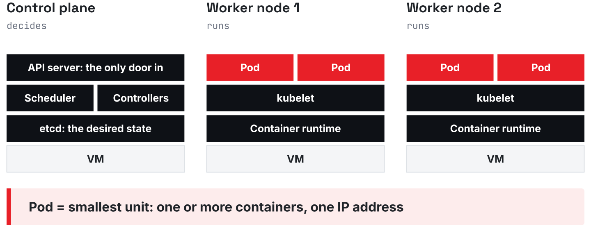

<!-- kicker: Lab 04 · Orchestration -->
# Lab 04 — Many copies: Kubernetes

*Run the Lab 03 app on a three-node Kubernetes cluster in your codespace, scale it, break it on purpose, update it without downtime, and find out who wins when your commands and your file disagree.*

`45 min` · `Codespaces · kind · kubectl` · `level: intro` · `submit: Merlin`

## Scenario

The agency's visit counter from Lab 03 is a hit, and one `web` container won't keep up. In Lab 03 you saw that Compose can't run three of them on one port. The agency also wants new versions online without taking the site down, and a crashed container replaced without anybody having to notice. You'll run the same app, the same image and the same Redis on **Kubernetes**: several `web` copies behind one name, a database whose data survives, and an update rolled out one copy at a time.

## Key ideas

In Lab 03, `--scale web=3` failed: three containers wanted port 80 on one machine. Lecture 4 named the kind of program that solves this, a **container orchestrator**, and the one almost everybody uses: **Kubernetes**.

- **Cluster.** A group of machines called **nodes**. The **control plane** decides what runs where, and the **worker nodes** run it. In a cloud, each node is a VM. Today **kind** (*Kubernetes in Docker*) runs each node as a Docker container in your codespace, so you get a real three-node cluster for free.



- **Pod, Deployment, Service.** A **Pod** is the smallest thing Kubernetes runs: one or more containers with one IP address. A **Deployment** keeps a set number of identical Pods running. A **Service** is one stable name and port in front of those Pods, and it spreads requests across them. Careful with the words: a *Compose* service becomes a Kubernetes *Deployment*.
- **Desired state.** You don't tell Kubernetes what to do, you tell it what you want: "three copies of `web`, image 1.0". **Controllers** keep comparing that with what is running and fix any difference. Scaling, healing and updating are all just a changed desired state.
- **Storage that outlives Pods.** Pods come and go, so the data lives in a **PersistentVolumeClaim**, the Kubernetes version of the named volume from Lab 03.

Part 2 runs the Lab 03 app on the cluster, Part 3 does what Compose couldn't (scale, heal, update), and Part 4 shows who wins when the file and your commands disagree.

## Learning outcomes

- Create a local Kubernetes **cluster** and inspect its nodes with `kubectl`.
- Deploy a multi-container app from a YAML file, and explain how **Deployments, Services, ConfigMaps and PersistentVolumeClaims** map to `compose.yaml`.
- **Scale** an app, watch Kubernetes **heal** it, and **roll out** and **roll back** a new version.
- Explain why the YAML file, not the commands you typed, is the **desired state**.

## Prerequisites

- [ ] **[Lab 03](../lab-03-compose/README.md) done:** you know the visit-counter app, `compose.yaml` and named volumes.
- [ ] **Lecture 4** helps: it explains Pods, Deployments and Services.

> [!TIP]
> **Use the copy button** at the top right of each code block, so multi-line commands stay intact.

## Part 1 — A cluster in your codespace · ~10 min

### 1.1 Open your machine and get the files

Open the [repository's main page](../README.md), click **Open in GitHub Codespaces** and create a codespace. Open a terminal (**☰ → Terminal → New Terminal**) and copy the Lab 03 app and this lab's two YAML files into one folder:

```bash
mkdir ~/lab04
cp /workspaces/Cloud-Computing/lab-03-compose/app/{app.py,Dockerfile,requirements.txt} ~/lab04/
cp /workspaces/Cloud-Computing/lab-04-kubernetes/{kind.yaml,k8s.yaml} ~/lab04/
cd ~/lab04
ls
```

> [!NOTE]
> **Expected output**
>
> ```
> Dockerfile  app.py  k8s.yaml  kind.yaml  requirements.txt
> ```

The app, the Dockerfile and the requirements are exactly the ones from Lab 03. [`kind.yaml`](kind.yaml) describes the cluster, and [`k8s.yaml`](k8s.yaml) describes the app.

### 1.2 Install kind and kubectl

Two tools, each a single program:

- **kind** creates and deletes the cluster.
- **kubectl** (say *cube control*) talks to the cluster's API server. Every Kubernetes command in this lab, and in any cloud, goes through it.

```bash
curl -sLo kind https://kind.sigs.k8s.io/dl/v0.33.0/kind-linux-amd64
curl -sLO https://dl.k8s.io/release/v1.37.3/bin/linux/amd64/kubectl
sudo install kind kubectl /usr/local/bin/
rm kind kubectl
kind version
kubectl version --client
```

> [!NOTE]
> **Expected output**
>
> ```
> kind v0.33.0 go1.26.7 linux/amd64
> Client Version: v1.37.3
> Kustomize Version: v5.8.1
> ```

### 1.3 Create the cluster

Look at the cluster description first:

```bash
cat kind.yaml
```

One control-plane node and two workers. The `extraPortMappings` lines connect port 80 of your codespace to port 30080 on the cluster, where the app will listen. Now create it. **It takes one to two minutes**, so read Part 2.1 while you wait:

```bash
time kind create cluster --name lab04 --config kind.yaml
```

> [!NOTE]
> **Expected output (your values will differ)**
>
> ```
> Creating cluster "lab04" ...
>  ✓ Ensuring node image (kindest/node:v1.37.0) 🖼
>  ✓ Preparing nodes 📦 📦 📦
>  ✓ Writing configuration 📜
>  ✓ Starting control-plane 🕹️
>  ✓ Installing CNI 🔌
>  ✓ Installing StorageClass 💾
>  ✓ Joining worker nodes 🚜
> Set kubectl context to "kind-lab04"
> ...
> real    1m38.060s
> ```

Wait until all three nodes are ready, then list them and look at what they really are:

```bash
kubectl wait --for=condition=Ready nodes --all --timeout=120s
kubectl get nodes
docker ps --format 'table {{.Names}}\t{{.Image}}\t{{.Ports}}'
```

> [!NOTE]
> **Expected output (your values will differ)**
>
> ```
> node/lab04-control-plane condition met
> node/lab04-worker condition met
> node/lab04-worker2 condition met
> NAME                  STATUS   ROLES           AGE   VERSION
> lab04-control-plane   Ready    control-plane   76s   v1.37.0
> lab04-worker          Ready    <none>          61s   v1.37.0
> lab04-worker2         Ready    <none>          61s   v1.37.0
> NAMES                 IMAGE                  PORTS
> lab04-worker2         kindest/node:v1.37.0
> lab04-worker          kindest/node:v1.37.0
> lab04-control-plane   kindest/node:v1.37.0   127.0.0.1:43915->6443/tcp, 0.0.0.0:80->30080/tcp
> ```

Each node is a Docker container. Port 6443 on the control plane is the **API server**, the one door that `kubectl` knocks on.

> [!TIP]
> **Common errors**
>
> - `node(s) already exist for a cluster with the name "lab04"`: you already created it. Carry on, or start over with `kind delete cluster --name lab04`.
> - `Bind for 0.0.0.0:80 failed: port is already allocated`: a container from Lab 01–03 is still running on port 80. Remove it with `docker rm -f $(docker ps -q --filter publish=80)`, then `kind delete cluster --name lab04` and create the cluster again.

> [!IMPORTANT]
> **In the report**
>
> The three node names, the Kubernetes version (VERSION column) and the `real` time of `kind create cluster`. In Lab 01 you timed how long one container took to start: compare.

## Part 2 — The Lab 03 app on the cluster · ~12 min

### 2.1 Read `k8s.yaml`

```bash
cat k8s.yaml
```

It's longer than `compose.yaml` because each idea is a separate object. The comments in the file say which part of `compose.yaml` each object replaces:

| Object | Replaces in `compose.yaml` | What it does |
|---|---|---|
| Deployment `web`, `replicas: 3` | the service `web` | keeps three Pods from the image `lab03-web:1.0` running |
| Service `web`, `NodePort` 30080 | the name `web` and `ports: "80:8000"` | one stable name and port in front of all `web` Pods; spreads requests across them |
| Deployment `redis` | the service `redis` | one Redis Pod |
| Service `redis` | the name `redis` | the name `app.py` connects to, as in Lab 03 |
| PersistentVolumeClaim `redis-data` | the named volume `redis-data` | storage that outlives the Redis Pod |
| ConfigMap `student` (you create it in 2.3) | `environment:` and `.env` | your name and codespace name, handed to every `web` Pod at start |

A request from your browser takes this path: codespace port 80 → node port 30080 (`kind.yaml`) → Service `web` → one of the `web` Pods, port 8000.

The `readinessProbe` lines do the job of the Compose `healthcheck`: a Pod gets traffic only once it answers.

### 2.2 Build the image and load it into the cluster

```bash
docker build -t lab03-web:1.0 .
kind load docker-image lab03-web:1.0 --name lab04
```

The nodes are separate machines with their own container runtime, and they can't see the images in your codespace's Docker. `kind load` copies the image into every node. A cluster in the cloud would pull it from a registry instead, such as GHCR from Lab 02.

> [!NOTE]
> **Expected output of `kind load` (your values will differ)**
>
> ```
> Image: "lab03-web:1.0" with ID "sha256:d29384a6…" not yet present on node "lab04-worker2", loading...
> Image: "lab03-web:1.0" with ID "sha256:d29384a6…" not yet present on node "lab04-worker", loading...
> Image: "lab03-web:1.0" with ID "sha256:d29384a6…" not yet present on node "lab04-control-plane", loading...
> ```

### 2.3 Your name as a ConfigMap

In Lab 03 your name came from a `.env` file. In Kubernetes, settings live in a **ConfigMap**. Replace **Your Name** with your name:

```bash
kubectl create configmap student \
  --from-literal=STUDENT_NAME="Your Name" \
  --from-literal=CODESPACE_NAME="$CODESPACE_NAME"
kubectl get configmap student -o yaml | grep -A2 '^data:'
```

> [!NOTE]
> **Expected output (your values will differ)**
>
> ```
> configmap/student created
> data:
>   CODESPACE_NAME: fuzzy-space-giggle-x5r4…
>   STUDENT_NAME: Your Name
> ```

### 2.4 Start the app

```bash
kubectl apply -f k8s.yaml
kubectl wait --for=condition=Ready pods --all --timeout=120s
kubectl get pods -o wide
```

`apply` sends the whole file to the API server: *this is what I want*. The scheduler then picks a node for each Pod.

> [!NOTE]
> **Expected output (your values will differ)**
>
> ```
> deployment.apps/web created
> service/web created
> deployment.apps/redis created
> service/redis created
> persistentvolumeclaim/redis-data created
> pod/redis-d44b44dbb-s6d9s condition met
> pod/web-7fb9c9c87d-7whqh condition met
> pod/web-7fb9c9c87d-c6kx2 condition met
> pod/web-7fb9c9c87d-dzx2k condition met
> NAME                    READY   STATUS    RESTARTS   AGE   IP           NODE            NOMINATED NODE   READINESS GATES
> redis-d44b44dbb-s6d9s   1/1     Running   0          12s   10.244.1.4   lab04-worker2   <none>           <none>
> web-7fb9c9c87d-7whqh    1/1     Running   0          12s   10.244.2.2   lab04-worker    <none>           <none>
> web-7fb9c9c87d-c6kx2    1/1     Running   0          12s   10.244.1.2   lab04-worker2   <none>           <none>
> web-7fb9c9c87d-dzx2k    1/1     Running   0          12s   10.244.2.3   lab04-worker    <none>           <none>
> ```

Look at the NODE column: the Pods are spread over both workers, and none runs on the control plane. Each Pod has its **own IP address**, so all three `web` Pods can listen on port 8000 without a conflict.

> [!TIP]
> **Common errors**
>
> - STATUS `ErrImagePull` or `ImagePullBackOff`: the node can't find `lab03-web:1.0`, so it tries Docker Hub and fails. Run the `kind load` line from 2.2 again, check that the tag is exactly `1.0`, then `kubectl rollout restart deployment web`.
> - STATUS `CreateContainerConfigError`: the ConfigMap `student` is missing. Create it (2.3), and the Pods start by themselves within a few seconds.
> - `timed out waiting for the condition`: run `kubectl get pods` and look at the STATUS column for one of the errors above.

### 2.5 Open it

Send six requests from the terminal:

```bash
for i in 1 2 3 4 5 6; do curl -s localhost | grep -E "Visits|hostname"; done
```

> [!NOTE]
> **Expected output (your values will differ)**
>
> ```
>   <li>Visits: <b>1</b></li>
>   <li>Web container (hostname): <code>web-7fb9c9c87d-c6kx2</code></li>
>   <li>Visits: <b>2</b></li>
>   <li>Web container (hostname): <code>web-7fb9c9c87d-7whqh</code></li>
>   <li>Visits: <b>3</b></li>
>   <li>Web container (hostname): <code>web-7fb9c9c87d-7whqh</code></li>
>   <li>Visits: <b>4</b></li>
>   <li>Web container (hostname): <code>web-7fb9c9c87d-dzx2k</code></li>
>   ...
> ```

The hostname of a container in a Pod is the **Pod name**. Different Pods answer, chosen by the Service, and the count still goes up by one each time, because all of them share one Redis.

> [!TIP]
> **All six answers from the same Pod?** Wait ten seconds and run the loop again. A Pod that has just become ready joins the Service a moment later.

Make the page reachable: **Ports** tab → port **80** → right-click → **Port Visibility → Public**. Open the **Forwarded Address** in a browser.

**Take Screenshot A now:** the browser with the **forwarded address in the address bar** and your page (your name, the visit count, a Pod name and your codespace name).

> [!TIP]
> **The browser keeps showing the same Pod?** The Service picks a Pod for each new *connection*, and a browser keeps its connection open for a while. `curl` opens a new one every time, so the terminal shows the spreading better.

> [!IMPORTANT]
> **In the report**
>
> Which node each Pod ran on (2.4), and the Pod names that answered your six requests (2.5).

## Part 3 — What Compose couldn't do · ~13 min

### 3.1 Scale

```bash
kubectl scale deployment web --replicas 5
kubectl rollout status deployment web
kubectl get pods -o wide -l app=web
```

`-l app=web` shows only Pods with the label `app: web`, the same label the Service uses to find them. You now have five `web` Pods, and none of them fought over a port.

> [!NOTE]
> **Expected output (your values will differ)**
>
> ```
> deployment.apps/web scaled
> Waiting for deployment "web" rollout to finish: 3 of 5 updated replicas are available...
> Waiting for deployment "web" rollout to finish: 4 of 5 updated replicas are available...
> deployment "web" successfully rolled out
> NAME                   READY   STATUS    RESTARTS   AGE   IP           NODE            ...
> web-7fb9c9c87d-72ht8   1/1     Running   0          11s   10.244.1.5   lab04-worker2   ...
> web-7fb9c9c87d-7whqh   1/1     Running   0          44s   10.244.2.2   lab04-worker    ...
> web-7fb9c9c87d-c6kx2   1/1     Running   0          44s   10.244.1.2   lab04-worker2   ...
> web-7fb9c9c87d-dzx2k   1/1     Running   0          44s   10.244.2.3   lab04-worker    ...
> web-7fb9c9c87d-j4x2z   1/1     Running   0          11s   10.244.2.5   lab04-worker    ...
> ```

### 3.2 Break it on purpose

Copy the name of **one** `web` Pod from the list above, put it in the first line below instead of the example, and run all three lines:

```bash
kubectl delete pod web-7fb9c9c87d-72ht8   # ← your Pod's name
kubectl get pods -l app=web
kubectl get deployment web
```

> [!NOTE]
> **Expected output (your values will differ)**
>
> ```
> pod "web-7fb9c9c87d-72ht8" deleted from default namespace
> NAME                   READY   STATUS    RESTARTS   AGE
> web-7fb9c9c87d-7whqh   1/1     Running   0          47s
> web-7fb9c9c87d-c6kx2   1/1     Running   0          47s
> web-7fb9c9c87d-dzx2k   1/1     Running   0          47s
> web-7fb9c9c87d-glsl9   0/1     Running   0          2s
> web-7fb9c9c87d-j4x2z   1/1     Running   0          14s
> NAME   READY   UP-TO-DATE   AVAILABLE   AGE
> web    4/5     5            4           47s
> ```

The Pod you deleted is gone, and a new one, a few seconds old, has taken its place. Nobody typed a command to start it. The Deployment still says *five*, and it saw four.

### 3.3 Roll out a new version, then roll it back

Version 2.0 of the app says *Hi* instead of *Hello*. Change the code, build the new image, load it and tell the Deployment to use it:

```bash
sed -i 's/Hello from/Hi from/' app.py
docker build -t lab03-web:2.0 .
kind load docker-image lab03-web:2.0 --name lab04
kubectl set image deployment/web web=lab03-web:2.0
kubectl rollout status deployment web
curl -s localhost | grep h1
kubectl get replicasets
```

> [!NOTE]
> **Expected output, from `set image` on (your values will differ)**
>
> ```
> deployment.apps/web image updated
> Waiting for deployment "web" rollout to finish: 2 out of 5 new replicas have been updated...
> Waiting for deployment "web" rollout to finish: 3 out of 5 new replicas have been updated...
> ...
> Waiting for deployment "web" rollout to finish: 1 old replicas are pending termination...
> deployment "web" successfully rolled out
> <h1>Hi from Your Name</h1>
> NAME              DESIRED   CURRENT   READY   AGE
> redis-d44b44dbb   1         1         1       92s
> web-7df998fb79    5         5         5       37s
> web-7fb9c9c87d    0         0         0       92s
> ```

A Deployment doesn't manage Pods directly. For each version it creates a **ReplicaSet**, and the ReplicaSet keeps the Pods. That's where the middle part of each Pod name comes from: `web-7fb9c9c87d-…` is version 1.0, `web-7df998fb79-…` is 2.0. During the update Kubernetes started new Pods a few at a time and stopped old ones only once the new ones were ready, so some Pods answered all the time.

Version 2.0 turns out to be a mistake. Go back:

```bash
kubectl rollout undo deployment web
kubectl rollout status deployment web
curl -s localhost | grep h1
kubectl get replicasets
```

> [!NOTE]
> **Expected output (your values will differ)**
>
> ```
> deployment.apps/web rolled back
> ...
> deployment "web" successfully rolled out
> <h1>Hello from Your Name</h1>
> NAME              DESIRED   CURRENT   READY   AGE
> redis-d44b44dbb   1         1         1       2m
> web-7df998fb79    0         0         0       50s
> web-7fb9c9c87d    5         5         5       2m
> ```

> [!TIP]
> **A `Warning` about `last-applied-configuration`?** That's expected. Kubernetes is telling you that the running Deployment and your `k8s.yaml` no longer say the same thing. Part 4 shows why that matters.

**Take Screenshot B now:** your terminal with both `<h1>` lines and both `kubectl get replicasets` tables. If it doesn't fit on one screen, take two (B1 and B2).

## Part 4 — Who wins: your commands or your file? · ~6 min

### 4.1 Predict, then apply the file again

```bash
kubectl get deployment web
grep -m1 replicas k8s.yaml
```

The cluster runs five `web` Pods since 3.1, but `k8s.yaml` still says three. **Before you run the next lines, write in your report how many `web` Pods you expect** after applying the file again:

```bash
kubectl apply -f k8s.yaml
kubectl get deployment web
```

> [!NOTE]
> **Expected output (your values will differ)**
>
> ```
> deployment.apps/web configured
> service/web unchanged
> deployment.apps/redis unchanged
> service/redis unchanged
> persistentvolumeclaim/redis-data unchanged
> NAME   READY   UP-TO-DATE   AVAILABLE   AGE
> web    3/3     3            3           98s
> ```

Only `web` was *configured*: Kubernetes compared the file with what was running and changed just the difference.

### 4.2 Replace the database Pod

Note the count, delete the Redis Pod, wait for its replacement and check again:

```bash
curl -s localhost | grep Visits
kubectl delete pod -l app=redis
kubectl wait --for=condition=Ready pods -l app=redis --timeout=60s
curl -s localhost | grep Visits
kubectl get pvc
```

> [!NOTE]
> **Expected output (your values will differ)**
>
> ```
>   <li>Visits: <b>22</b></li>
> pod "redis-d44b44dbb-s6d9s" deleted from default namespace
> pod/redis-d44b44dbb-tz9lx condition met
>   <li>Visits: <b>23</b></li>
> NAME         STATUS   VOLUME                                     CAPACITY   ACCESS MODES   STORAGECLASS   ...
> redis-data   Bound    pvc-25696b16-933c-4b3a-be9d-7970a5e58548   100Mi      RWO            standard       ...
> ```

A new Redis Pod, and the count went on from where it was. As in Lab 03, Redis saved the count to `/data` when it was stopped, and `/data` is the PersistentVolumeClaim, which doesn't belong to any one Pod. kind keeps the volume on a node's disk; in a cloud it would be a managed disk.

> [!IMPORTANT]
> **In the report**
>
> Your prediction and the result of 4.1, and the two `Visits` values from 4.2.

## Part 5 — Clean up · ~4 min

### 5.1 Delete the cluster

```bash
kind delete cluster --name lab04
kind get clusters
docker image rm lab03-web:1.0 lab03-web:2.0
```

> [!NOTE]
> **Expected output**
>
> ```
> Deleting cluster "lab04" ...
> Deleted nodes: ["lab04-worker2" "lab04-worker" "lab04-control-plane"]
> No kind clusters found.
> ```

Deleting the cluster deletes its nodes, and with them every Pod, Service and volume in it.

### 5.2 Delete the codespace

<https://github.com/codespaces> → **⋯** next to your codespace → **Delete**.

> [!WARNING]
> **Why this matters**
>
> Three nodes keep running in your codespace until you delete them, and the codespace uses your free core-hours. In a cloud, a cluster's control plane and its worker VMs are billed every hour, even when nobody visits the site (Lecture 4).

## Where this shows up

- **Managed Kubernetes.** Amazon EKS, Azure Kubernetes Service and Google Kubernetes Engine run the control plane for you. You use the same `kubectl` and the same kind of YAML as today.
- **Registries instead of `kind load`.** A cloud cluster pulls its images from a registry such as GHCR (Lab 02) or Amazon ECR (Lab 05).
- **A public address.** Instead of a NodePort, a Service of type LoadBalancer or an Ingress gets a public address and a load balancer from the cloud provider.
- **No cluster at all.** Services such as Amazon ECS with Fargate (Lab 05), Google Cloud Run and Azure Container Apps run your containers without a cluster to manage.

Reference, if you want the official version: kind's [Quick Start](https://kind.sigs.k8s.io/docs/user/quick-start/), and in the Kubernetes documentation [Deployments](https://kubernetes.io/docs/concepts/workloads/controllers/deployment/), [Service](https://kubernetes.io/docs/concepts/services-networking/service/), [Persistent Volumes](https://kubernetes.io/docs/concepts/storage/persistent-volumes/) and the [kubectl Quick Reference](https://kubernetes.io/docs/reference/kubectl/quick-reference/).

## Submission · any time before the first exam period

Submit on Merlin whenever you're ready. The only hard deadline: **all labs must be in before the first exam period begins**, if you pass the course through the midterms or your seminar paper. Submitting within about two weeks works best, while the lab is still fresh and before the lectures build on it.

> [!IMPORTANT]
> **To Merlin**
>
> `lab04_<surname>.pdf` with:
>
> 1. **Your data:** GitHub username, codespace name, the node names, the Kubernetes version and the `real` time of `kind create cluster` (1.3), which node each Pod ran on and the Pod names from your six requests (2.4, 2.5).
> 2. **Screenshot A:** your page in a browser, with the **forwarded address in the address bar** (2.5).
> 3. **Screenshot B** (3.3), **your prediction and the result** from 4.1, and **the two counts** from 4.2.
> 4. **Short answers**, in your own words:
>    - Which object did you scale in 3.1, and which one kept the same name and port the whole time? Why did five `web` copies work here, when `--scale web=3` failed in Lab 03?
>    - Who started the new Pod in 3.2, and how did it know that one was missing?
>    - What happened to the two ReplicaSets during the update and during the undo (3.3)? Why did the app keep answering?
>    - Explain your result in 4.1. What does it say about `kubectl scale` compared with the YAML file? Which of the two would you trust, and why?
>    - Where was the visit count while the Redis Pod was replaced (4.2)? Which object in `k8s.yaml` made that possible, and what did it replace from `compose.yaml`?

| Item | Required |
|---|:-:|
| Your data, prediction, counts and screenshots A–B, consistent with each other (same codespace, Pod names, ReplicaSets, counts) | ✓ |
| Short answers, using your own outputs | ✓ |

*Your report is about **your** run: your codespace, your cluster, your Pods. Reports that don't match each other or look copied will be checked again, and I may ask you to walk me through your report.*
